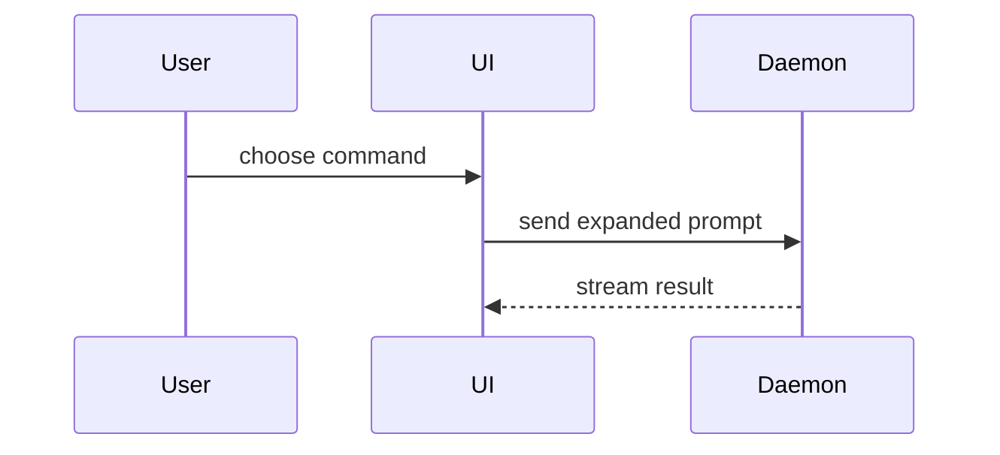

If repository has own PR template (for example `.github/pull_request_template.md`, `.github/PULL_REQUEST_TEMPLATE/`, or `.gitlab/merge_request_templates/`), follow that template instead. Borrow from this one only sections that template does not cover.

Otherwise, use this template for PR body:

```markdown
## Summary

<diagram, diff-sketch, or tree>

## Evidence

- **Before:** <screenshot/output/failing test run>
  **After:** <screenshot/output/passing test run>

## Merge Danger

**Door:** <one-way or two-way>

<optional: description>

**Blast Radius:** <one-word description>

<optional: potential ramifications of merge>
```

## Sections

Skip all preambles. Keep prose brief. Use user's domain language from `GLOSSARY.md`.

### Summary

Pick smallest view that makes key point clear.

- Show logic or algorithm as pseudocode:

```text
on(save)
  if content is unchanged
    return cached result
  write new content
  return fresh result
```

- Show runtime control flow as call tree:

```text
submitForm
  createSession
    persistPrompt
    launchAgent
  navigateToSession
```

- Show UI structure as component tree, with state and module boundaries that matter:

```text
<SessionPage> (apps/example/src/routes/session.tsx)
  useSessionEvents()
  <SessionToolbar>
    <RunSkillButton> (packages/ui)
```

- Show file responsibility or broad refactor as shallow file tree:

```text
src/
├── commands/       # parses user actions
├── sessions/       # owns session state
└── transport/      # sends API requests
```

- Show component interaction, control flow, or data flow with Mermaid:



- Use `diff` when point is what changes and surrounding shape already exists. Match diff shape to topic.

For component change:

```diff
 <SessionPage>
   useSessionEvents()
   <SessionToolbar>
+    <RunSkillButton />
   <SessionTimeline>
+    <SkillResultCard />
```

For file-layout change:

```diff
 src/
 ├── commands/
+│   └── show-me.ts       # expands the slash command
 ├── sessions/
-└── transport.ts
+└── transport/
+    ├── client.ts
+    └── stream.ts
```

For call-tree or call-stack change:

```diff
 submitForm
   createSession
     persistPrompt
+    expandSkillMention
     launchAgent
-  navigateToSession
+  navigateToSession
+    subscribeToEvents
```

For state or control-flow change:

```diff
 on(save)
-  write content
+  if content is unchanged
+    return cached result
+  write new content
+  invalidate cache
```

- Show whole block when most of it is new, when omitted context would hide ownership or order, or when user needs copyable target shape:

```ts
function expandSkill(command: string): string {
  const skillName = command.slice(1);
  return `use the ${skillName} skill`;
}
```

#### Guidance

Place each visual next to short text it supports. Keep only calls, files, props, states, and boundaries needed to answer user's current question or options to resolve current discussion point.

Use one view or several; rarely all. Do not overwhelm user.

### Evidence

Concrete evidence change works. Show before and after.

Screenshots are S-tier when environment is set up for them and change is visual.

Execution-based evidence is A-tier: test results, console output. Show exact test that now fails and passes, using pseudocode.

Before pasting output or screenshots, redact tokens, keys, env dumps, internal hostnames and personal data.

### Merge Danger

Describe whether PR is one-way or two-way door. Two-way doors can be walked back; one-way doors cannot. PR cheap to roll back is lower risk. Destructive actions or hard-to-reverse decisions are one-way doors.

Blast radius is potential impact or scope of changes this PR introduces. Consider all possibilities. Examples: layout shift, breakages for consumers, mobile responsiveness, etc.
